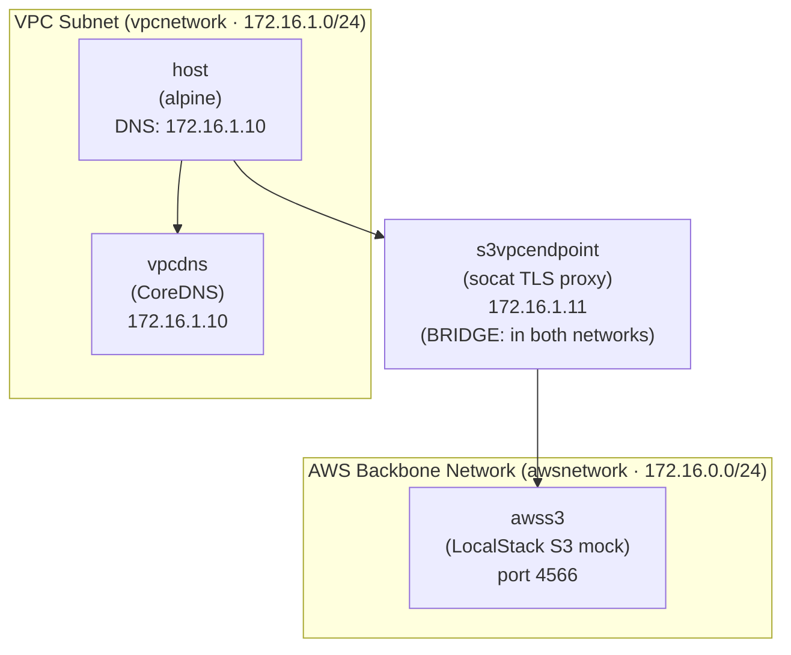
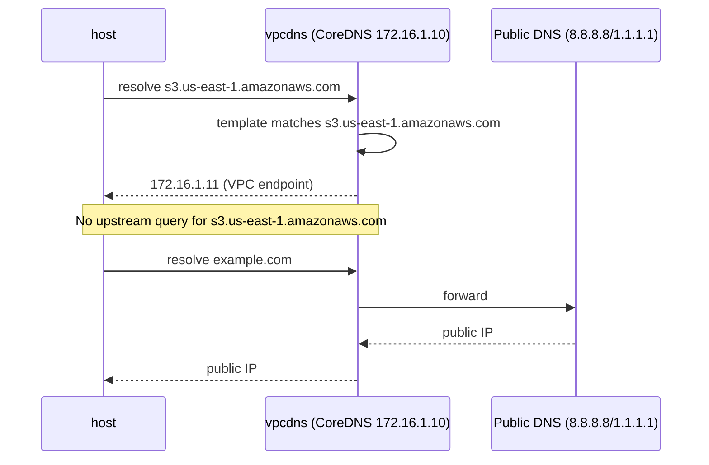
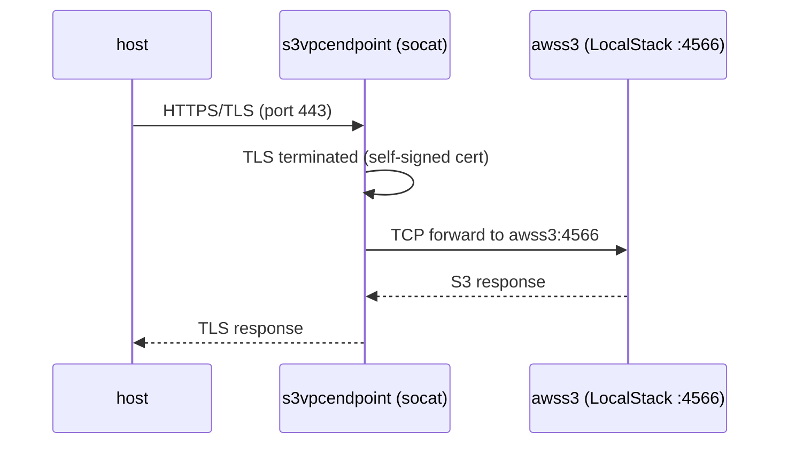

# Mimic AWS VPC Endpoints to Services

## Setup:
* AWS Backbone Network (```awsnetwork***) where all AWS Services live
* VPC Subnet (can be private or even isolated - ```vpcnetwork```) with VPC Endpoint providing a direct link (not via the subnets NAT endpoint) to an AWS Service (here: S3)
* adding the DNS records to resolve requests for ```s3.us-east-1.amazonaws.com``` to our custom VPC Endpoint
* the VPC endpoint in the VPC subnet (running ```socat```) forwards the TCP (via SSL) connection to the S3 mock in the AWS Backbone Network
* the host in the VPC subnet resolves the S3 service DNS record to the IP address of the VPC Endpoint and all requests to interact with S3 go via the endpoint instead of the network's NAT and the internet
* that way we ensure our S3 communication never leaves our isolated network and travels over the internet

## Network Setup & VPC Endpoint Mock

### Architecture Overview



- **awsnetwork** (172.16.0.0/24): AWS backbone where `awss3` (LocalStack S3) lives.
- **vpcnetwork** (172.16.1.0/24): private VPC subnet.

> Note: `s3vpcendpoint` is the only service attached to **both** `awsnetwork` and `vpcnetwork`, acting as the bridge between the VPC subnet and the AWS backbone.
### DNS Override (CoreDNS)

`Corefile` makes every `*.s3.us-east-1.amazonaws.com` name resolve to the VPC endpoint IP instead of public AWS IPs. With that pattern we leave other AWS services out of the picture and limit the endpoint to the S3 service only:



### Traffic Forwarding (socat)

The VPC endpoint terminates TLS locally (self-signed cert, CN=amazonaws.com) and forwards the raw TCP stream to LocalStack:



Command: `socat OPENSSL-LISTEN:443,cert=/tmp/server.pem,verify=0,fork,reuseaddr TCP:awss3:4566`

### End-to-End Request Flow

1. `host` resolves `s3.us-east-1.amazonaws.com` via `vpcdns` → `172.16.1.11`.
2. `host` opens HTTPS to `172.16.1.11:443` (the VPC endpoint).
3. `s3vpcendpoint` (socat) terminates TLS and forwards the TCP stream to `awss3:4566`.
4. `awss3` (LocalStack) handles the S3 request and replies.
5. Response travels back through the endpoint to `host`.

Traffic never leaves `vpcnetwork` toward the internet/NAT; it is contained within the Docker networks, mimicking an AWS VPC Gateway/Interface Endpoint that keeps S3 traffic on the AWS backbone.

### Test the connection from the host container
* install AWS Cli and curl: ```apk add aws-cli curl```
* test whether you can connect to the faked S3 endpoint: ```curl -v -k https://s3.us-east-1.amazonaws.com```. It should show something like:
```
<?xml version='1.0' encoding='utf-8'?>
<ListAllMyBucketsResult xmlns="http://s3.amazonaws.com/doc/2006-03-01/"><Owner><DisplayName>webfile</DisplayName><ID>75aa57f09aa0c8caeab4f8c24e99d10f8e7faeebf76c078efc7c6caea54ba06a</ID></Owner><Buckets /></ListAllMyBucketsResult>
* Connection #0 to host s3.us-east-1.amazonaws.com:443 left intact
```
* create new bucket using the AWS Cli: ```aws s3 mb s3://test --no-verify-ssl``` (needed because of the self-signed SSL certificate)
* list all buckets: ```aws s3 ls --no-verify-ssl``` which should yield:
```
/usr/lib/python3.14/site-packages/urllib3/connectionpool.py:1110: InsecureRequestWarning: Unverified HTTPS request is being made to host 's3.us-east-1.amazonaws.com'. Adding certificate verification is strongly advised. See: https://urllib3.readthedocs.io/en/latest/advanced-usage.html#tls-warnings
  warnings.warn(
2026-10-28 21:38:54 test
```
